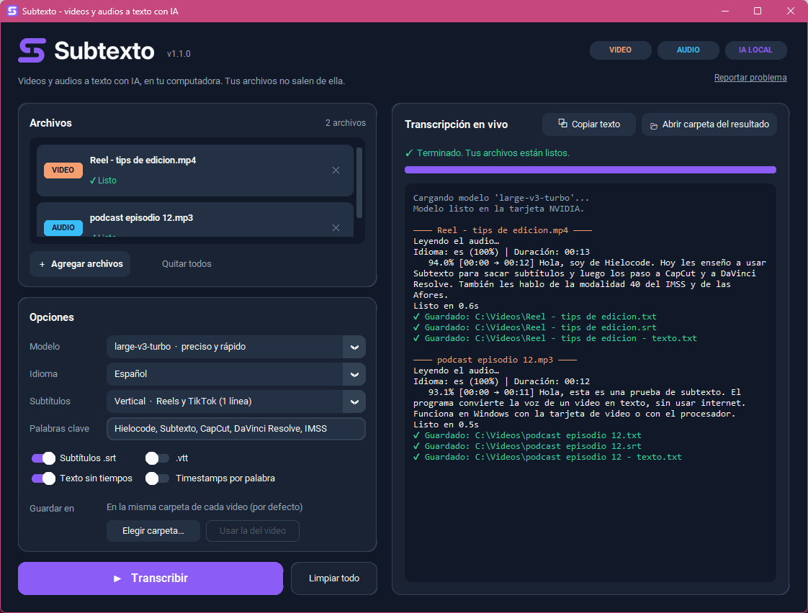

<h1 align="center">
  <picture>
    <source media="(prefers-color-scheme: dark)" srcset="brand/web/logo-oscuro.svg">
    
  </picture>
</h1>

<p align="center">
  Transcribe tus videos y audios a texto <b>con IA, en tu propia computadora</b>.<br>
  Sin pagar APIs y sin subir tus archivos a ningún lado.<br>
  <a href="https://subtexto.hieloco.de"><b>subtexto.hieloco.de</b></a>
</p>

<p align="center">
  <a href="https://github.com/davidhielo91/subtexto/releases/latest"></a>
  
  
  
</p>

---

## ¿Qué es?

**Subtexto** es un programa para **Windows** que toma un video (o un audio), escucha lo que se dice y te entrega:

- 📝 Un archivo **`.txt`** con la transcripción y el **minuto y segundo** de cada frase.
- 🎬 Subtítulos **`.srt`** en **líneas cortas**, listos para CapCut, Premiere, DaVinci Resolve, YouTube, Reels, etc.
- 🌐 Opcional: subtítulos **`.vtt`** para web y YouTube.

Usa **[Whisper](https://github.com/openai/whisper)**, la IA de reconocimiento de voz de OpenAI, a través de **[faster-whisper](https://github.com/SYSTRAN/faster-whisper)**, que corre **100% en tu PC**. Si tienes una tarjeta de video NVIDIA la usa automáticamente y es muchísimo más rápido. Si no, funciona con el procesador.

<p align="center">
  
</p>

## ¿Para qué sirve?

- Sacar el texto de tus videos para hacer **posts, blogs, newsletters o descripciones** (con el botón **Copiar texto** lo pegas directo en ChatGPT, Claude o un documento, o guárdalo como archivo con **Texto sin tiempos**).
- Generar **subtítulos** para YouTube, y para **Reels, TikTok y Shorts** en líneas cortas que no tapan la pantalla.
- Encontrar rápido **en qué minuto** se dijo algo dentro de un video largo.
- Transcribir **clases, reuniones, podcasts o notas de voz** (incluidas las de WhatsApp `.opus`).
- Todo con **privacidad**: tus archivos nunca salen de tu computadora.

## Características

- ✅ Interfaz moderna en modo oscuro: **arrastra y suelta** tus archivos o **carpetas completas**.
- ✅ Cada archivo muestra si es **video** o **audio** y su avance (en espera, transcribiendo, listo).
- ✅ Transcribe **varios archivos seguidos**, y puedes **detener** en cualquier momento sin perder lo que ya se transcribió.
- ✅ Detecta el idioma solo (o lo eliges tú: español, inglés, portugués, francés…).
- ✅ Timestamps en formato `[mm:ss → mm:ss]`, y opcionalmente **por palabra**.
- ✅ Subtítulos `.srt` (y `.vtt`) en dos formatos: **horizontal** (YouTube, máximo 2 líneas de 42 caracteres) y **vertical** (Reels/TikTok, 1 línea corta de hasta 24 caracteres).
- ✅ **Palabras clave**: le dices los nombres propios y marcas que aparecen en el video y los escribe bien.
- ✅ **Texto sin tiempos**: guarda también un archivo solo con el texto en párrafos, listo para un post o un blog.
- ✅ **Nunca sobrescribe**: si ya existe `mi_video.txt`, guarda `mi_video (2).txt`.
- ✅ Eliges **dónde guardar** los resultados (por defecto, junto al video), y **recuerda tus opciones**.
- ✅ Filtro de voz (VAD) que salta silencios y música, y reduce frases inventadas.
- ✅ También se puede usar desde la **terminal**.
- ✅ Acepta video y audio: `mp4, mov, mkv, avi, webm, m4v, wmv, flv, mp3, wav, m4a, aac, ogg, opus, flac`.

## Ejemplo del resultado

**`mi_video.txt`**
```
Transcripción de: mi_video.mp4
Idioma: es | Duración: 12:47 | Modelo: large-v3-turbo

[00:00 → 00:02]  Hola, bienvenidos a un nuevo video.
[00:02 → 00:07]  Hoy les voy a enseñar cómo transcribir sus videos con inteligencia artificial,
[00:07 → 00:13]  y lo mejor es que todo corre en su propia computadora.
```

**`mi_video.srt`** (horizontal)
```
1
00:00:00,000 --> 00:00:02,160
Hola, bienvenidos a un nuevo video.

2
00:00:02,780 --> 00:00:07,220
Hoy les voy a enseñar cómo transcribir
sus videos con inteligencia artificial,
```

**`mi_video.srt`** (vertical, para Reels y TikTok)
```
1
00:00:00,000 --> 00:00:01,700
Hola, bienvenidos

2
00:00:01,700 --> 00:00:02,160
a un nuevo video.
```

**`mi_video - texto.txt`** (texto sin tiempos)
```
Hola, bienvenidos a un nuevo video. Hoy les voy a enseñar cómo transcribir sus videos con inteligencia artificial, y lo mejor es que todo corre en su propia computadora.
```

---

## Instalación (Windows 10/11)

### Opción 1: descarga el instalador (recomendado)

1. Descarga **[Subtexto-Setup.exe](https://github.com/davidhielo91/subtexto/releases/latest/download/Subtexto-Setup.exe)** (también está en [Releases](https://github.com/davidhielo91/subtexto/releases/latest)).
2. Ábrelo y sigue los pasos. No necesitas instalar Python ni nada más: todo viene incluido.
3. Elige el **modelo de IA** que quieres descargar (el recomendado es `large-v3-turbo`). Si tienes una tarjeta **NVIDIA**, la opción de **aceleración NVIDIA** aparece marcada sola.
4. Al terminar, abre **Subtexto** desde el menú Inicio o el acceso directo del escritorio.

> 🛡️ **"Windows protegió tu PC"**: aparece porque el instalador no tiene firma digital (es un certificado de pago). Haz clic en **Más información → Ejecutar de todas formas**. El código completo está en este repositorio.

### Opción 2: un solo comando

Abre **PowerShell** y pega:

```powershell
irm https://raw.githubusercontent.com/davidhielo91/subtexto/main/instalar.ps1 | iex
```

Descarga la última versión del instalador y lo abre.

### Requisitos

| Qué | Para qué | Obligatorio |
|---|---|---|
| **Windows 10/11 de 64 bits** | Subtexto solo funciona en Windows | Sí |
| **Espacio en disco** | ~300 MB del programa + el modelo (0.5 a 3 GB) + 1.4 GB si usas NVIDIA | Sí |
| **Tarjeta NVIDIA** (4 GB de memoria de video o más) | Transcribir mucho más rápido | No (sin ella usa el procesador) |
| **Internet** | Solo durante la instalación y la primera vez que usas otro modelo | Solo al principio |

Para desinstalarlo: **Configuración → Aplicaciones → Subtexto → Desinstalar** (también borra los modelos que bajó el instalador).

---

## Cómo se usa

1. Abre **Subtexto**.
2. **Arrastra** tus videos o audios a la lista (o usa **＋ Agregar archivos**). También puedes soltar una **carpeta**: se agregan todos los videos y audios que tenga adentro. Puedes quitar uno con la **✕** o todos con **Quitar todos**.
3. Elige las opciones (puedes dejar las de por defecto; la próxima vez que abras el programa las recuerda):
   - **Modelo:** qué tan precisa es la IA (ver tabla abajo).
   - **Idioma:** "Detectar automáticamente" o el idioma del video.
   - **Subtítulos:** **Horizontal** (YouTube, 2 líneas) o **Vertical** (Reels y TikTok, 1 línea corta que cambia más rápido).
   - **Palabras clave:** nombres propios, marcas o términos que aparecen en el video, separados por comas (ej. `Hielocode, CapCut, DaVinci Resolve, IMSS`). Ayudan mucho a que la IA los escriba bien. Es una pista, no una regla: casi siempre los respeta, pero no siempre.
   - **Subtítulos .srt / .vtt:** genera también los archivos de subtítulos.
   - **Texto sin tiempos:** guarda también `mi_video - texto.txt`, solo con el texto en párrafos.
   - **Timestamps por palabra:** agrega el segundo exacto de cada palabra al `.txt`.
   - **Guardar en:** carpeta donde se guardan los resultados (por defecto, junto a cada video).
4. Presiona **▶ Transcribir**. Verás el texto aparecer en vivo.
   - Si te arrepientes, presiona **■ Detener**: se guarda lo transcrito hasta ese momento (el `.txt` lo marca como `[INCOMPLETO]`) y los demás archivos no se procesan. Funciona al instante en cualquier momento, también mientras lee el audio de un video largo.
5. Al terminar:
   - **Copiar texto** copia la transcripción **sin tiempos** (en párrafos), lista para pegar.
   - **Abrir carpeta del resultado** te lleva a tus archivos.
6. **Limpiar todo** deja la ventana como recién instalada (también regresa las opciones a las de fábrica).

> ⏳ **La primera vez** que usas un modelo que no bajó el instalador, se descarga (hasta 3 GB). Verás los MB descargados en la barra. Solo pasa una vez.

> 🔔 Al abrir, Subtexto revisa si hay una versión nueva en GitHub. Si la hay, aparece el enlace **"Hay una versión nueva"** arriba a la derecha. No descarga ni instala nada por su cuenta.

---

## ¿Qué modelo elegir?

| Modelo | Descarga | Precisión | Velocidad | Recomendado para |
|---|---|---|---|---|
| `large-v3-turbo` | ~1.6 GB | ⭐⭐⭐⭐½ | Rápido | **Casi todo (por defecto)** |
| `large-v3` | ~3 GB | ⭐⭐⭐⭐⭐ | Normal | Máxima calidad, audio difícil |
| `medium` | ~1.5 GB | ⭐⭐⭐⭐ | Rápido | Equipos con poca memoria de video |
| `small` | ~0.5 GB | ⭐⭐⭐ | Muy rápido | Pruebas o computadoras sin tarjeta NVIDIA |
| `base` | ~150 MB | ⭐⭐ | Rapidísimo | Borradores rápidos |

> Sin tarjeta NVIDIA, los modelos grandes pueden tardar más que la duración del video. En ese caso, prueba `small`.

El modelo que eliges en el instalador queda en la carpeta del programa (`modelos\`). Los demás se descargan la primera vez que los usas y se guardan en la caché de Hugging Face (`C:\Users\<tu usuario>\.cache\huggingface`). Puedes borrar esa carpeta para liberar espacio; se volverán a descargar cuando los uses.

---

## ¿Qué tan exacta es la transcripción?

El programa **no resume, no corrige y no reescribe nada**: guarda tal cual lo que la IA escucha. Pero la IA no es perfecta:

- Puede **escuchar mal** algunas palabras, sobre todo nombres propios, marcas, palabras en otro idioma, o partes con ruido o música. Para nombres y marcas, escríbelos en **Palabras clave**: en nuestras pruebas, "The Yellow Code" pasó a "Hielocode" y "Davin Sirisalvi" a "DaVinci Resolve".
- **Limpia un poco** la forma de hablar: normalmente quita muletillas ("eh", "este…") y agrega puntuación.
- **Rara vez** puede inventar una frase en partes sin voz (silencios o música), como *"Gracias por ver"*. El filtro de voz reduce mucho esto, pero no lo elimina por completo.
- Si **detecta mal el idioma**, puede escribir el texto traducido. Si sabes el idioma del video, elígelo en la opción **Idioma**.
- **No separa hablantes**: en entrevistas o podcasts no indica quién dice cada frase.
- **Videos largos sin bucles:** Whisper a veces se "engancha" y repite la misma frase hasta el final del video. Para evitarlo, Subtexto transcribe cada tramo de forma independiente y descarta frases repetidas (te avisa en el registro si lo hizo). Como efecto secundario, algunas frases pueden salir más cortas o con menos puntuación.

Para audio claro, la precisión suele ser muy alta. Si vas a publicar el texto tal cual o usarlo para algo importante, **revísalo**; los timestamps te ayudan a ir directo al momento exacto del video.

---

## Solución de problemas

<details>
<summary><b>Dice "No se pudo usar la tarjeta NVIDIA… Uso el procesador"</b></summary>

- Revisa que tengas una tarjeta NVIDIA con los **drivers actualizados** (en una terminal, `nvidia-smi` debe mostrar tu tarjeta).
- Si dice **"No encontré las librerías de NVIDIA"**: vuelve a abrir el instalador y deja marcada la opción **aceleración NVIDIA**. (Desde el código: `.\.venv\Scripts\pip install -r requirements-gpu.txt`.)
- En tarjetas más viejas Subtexto usa solo un **modo compatible** un poco más lento; es normal.
- Si aun así no funciona, el programa sigue funcionando con el procesador, solo más lento.
</details>

<details>
<summary><b>Error de memoria de la tarjeta ("no tiene memoria suficiente")</b></summary>

Usa un modelo más pequeño: `large-v3-turbo`, `medium` o `small`.
</details>

<details>
<summary><b>"No se pudo descargar el modelo"</b></summary>

Revisa tu conexión a internet y vuelve a intentarlo. Solo hace falta internet la primera vez que usas cada modelo.
</details>

<details>
<summary><b>Encontré un error: ¿cómo lo reporto?</b></summary>

Haz clic en **Reportar problema** (arriba a la derecha). Se abre la página para reportarlo en GitHub y la carpeta con el archivo **`subtexto.log`**: adjúntalo al reporte. Ese archivo guarda la versión, tu Windows, si usaste la tarjeta NVIDIA y los errores; **no guarda el texto de tus transcripciones**.

- Registro: `%LOCALAPPDATA%\Subtexto\subtexto.log`
- Opciones guardadas: `%APPDATA%\Subtexto\config.json`
</details>

---

## Para programadores

### Instalar desde el código

Necesitas **[Python 3.9 o superior](https://www.python.org/downloads/)**. ffmpeg es opcional: si no lo tienes, Subtexto usa la copia que trae faster-whisper.

```powershell
winget install Python.Python.3.12
git clone https://github.com/davidhielo91/subtexto.git
cd subtexto
```

Haz **doble clic en `instalar.bat`**: crea un entorno aislado (`.venv`), instala la IA y sus librerías (y las de GPU si detecta NVIDIA), revisa ffmpeg y ofrece crear un **acceso directo en el escritorio**. Después, doble clic en **`Subtexto.bat`**.

O paso a paso en PowerShell:

```powershell
python -m venv .venv
.\.venv\Scripts\python -m pip install --upgrade pip
.\.venv\Scripts\pip install -r requirements.txt
# Solo si tienes tarjeta NVIDIA:
.\.venv\Scripts\pip install -r requirements-gpu.txt
# Opcional: acceso directo en el escritorio
powershell -ExecutionPolicy Bypass -File .\crear_acceso_directo.ps1
```

### Desde la terminal

```powershell
# Básico (guarda .txt y .srt junto al video)
.\.venv\Scripts\python transcribir.py "C:\Videos\mi_video.mp4"

# Fijar idioma y modelo, y generar también .vtt
.\.venv\Scripts\python transcribir.py mi_video.mp4 --idioma es --modelo large-v3 --vtt

# Timestamps por palabra, sin .srt, y guardar en otra carpeta
.\.venv\Scripts\python transcribir.py mi_video.mp4 --palabras --sin-srt --salida "D:\Transcripciones\mi_video.txt"

# Subtítulos para Reels/TikTok, con nombres propios y el texto limpio aparte
.\.venv\Scripts\python transcribir.py mi_reel.mp4 --vertical --texto --palabras-clave "Hielocode, CapCut"

# Forzar procesador (CPU)
.\.venv\Scripts\python transcribir.py mi_video.mp4 --dispositivo cpu
```

Con **Ctrl+C** se detiene y guarda lo transcrito hasta ese momento. También puedes **arrastrar videos sobre `transcribir.bat`** para transcribirlos sin abrir la interfaz.

| Opción | Qué hace |
|---|---|
| `--modelo` | `tiny`, `base`, `small`, `medium`, `large-v3`, `large-v3-turbo` (por defecto) |
| `--idioma` | Código del idioma: `es`, `en`, `pt`, `fr`… (por defecto se detecta solo) |
| `--dispositivo` | `auto` (por defecto), `cuda` (tarjeta NVIDIA) o `cpu` |
| `--salida` | Ruta del `.txt` de salida (los subtítulos se guardan al lado) |
| `--palabras` | Incluye timestamps por palabra |
| `--sin-srt` | No genera el archivo `.srt` |
| `--vtt` | Genera también subtítulos `.vtt` |
| `--vertical` | Subtítulos de 1 línea corta, para video vertical (Reels, TikTok, Shorts) |
| `--texto` | Guarda también `mi_video - texto.txt`: solo el texto, en párrafos y sin tiempos |
| `--palabras-clave` | Nombres propios o marcas que debe reconocer, ej. `"Hielocode, CapCut"` |

### Pruebas

```powershell
.\.venv\Scripts\pip install -r requirements-dev.txt
.\.venv\Scripts\python -m pytest
```

Prueban lo que no necesita la IA: tiempos, cortes de subtítulos (horizontal y vertical), `.srt`/`.vtt`, texto sin tiempos, nombres sin sobrescribir, palabras clave, Detener (también mientras se lee el audio, con ffmpeg y con PyAV), filtro de frases repetidas y comparación de versiones. En GitHub corren solas en cada push (`.github/workflows/pruebas.yml`).

### Crear el instalador (Subtexto-Setup.exe)

Con Python e [Inno Setup 6.7+](https://jrsoftware.org/isinfo.php) (`winget install JRSoftware.InnoSetup`):

```powershell
powershell -ExecutionPolicy Bypass -File build\construir.ps1
```

Genera `build\salida\Subtexto-Setup.exe`: empaqueta el programa con PyInstaller (Python incluido) y arma el instalador con Inno Setup. La versión sale de **`version.py`** (la misma que muestra la app); para publicar una nueva, cámbiala ahí y crea el release en GitHub con la etiqueta `vX.Y.Z`. Los modelos y las librerías de NVIDIA no van dentro del `.exe`: el instalador los descarga de Hugging Face y PyPI (versiones fijas, verificadas con SHA-256).

Para probar el instalador en una computadora limpia, `build\probar-en-sandbox.ps1` lo abre en **Windows Sandbox** (viene en Windows 10/11 Pro; hay que activarlo una vez). Adentro no hay tarjeta NVIDIA, así que también sirve para probar el modo procesador.

### Estructura del proyecto

```
subtexto/
├── subtexto.pyw              # Interfaz gráfica
├── transcribir.py            # Motor de transcripción + uso desde terminal
├── version.py                # Versión de la app y del instalador
├── instalar.ps1              # Instalación con un comando (baja el Setup.exe)
├── instalar.bat              # Instalador desde el código
├── Subtexto.bat              # Abre la interfaz
├── transcribir.bat           # Arrastrar y soltar sin interfaz
├── crear_acceso_directo.ps1  # Crea el acceso directo en el escritorio
├── requirements.txt          # Librerías base
├── requirements-gpu.txt      # Librerías extra para tarjetas NVIDIA
├── requirements-dev.txt      # Para correr las pruebas
├── tests/                    # Pruebas (pytest)
├── .github/workflows/        # Corre las pruebas en GitHub en cada push
├── build/                    # Cómo se arma Subtexto-Setup.exe (PyInstaller + Inno Setup)
├── assets/                   # Ícono y logo que usa el programa (se regeneran con generar_icono.py)
├── brand/                    # Logo, íconos web, imágenes para redes y guía de marca
└── docs/                     # Captura de pantalla
```

---

## Créditos

- [Whisper](https://github.com/openai/whisper) de OpenAI: el modelo de reconocimiento de voz (licencia MIT).
- [faster-whisper](https://github.com/SYSTRAN/faster-whisper) de SYSTRAN: versión optimizada de Whisper (licencia MIT).
- [FFmpeg](https://ffmpeg.org/) y [PyAV](https://github.com/PyAV-Org/PyAV): lectura de audio y video.
- [PyInstaller](https://pyinstaller.org/) e [Inno Setup](https://jrsoftware.org/isinfo.php): el instalador para Windows.
- [CustomTkinter](https://github.com/TomSchimansky/CustomTkinter) de Tom Schimansky: diseño de la interfaz.
- [tkinterdnd2](https://github.com/Eliav2/tkinterdnd2): arrastrar y soltar en la interfaz.
- [Pillow](https://python-pillow.org/): imágenes del ícono y del logo.
- [Inter](https://rsms.me/inter/) de Rasmus Andersson: la tipografía del logotipo (SIL Open Font License 1.1).

La lista completa de software de terceros y sus licencias está en [AVISOS-DE-TERCEROS.txt](AVISOS-DE-TERCEROS.txt).

## Licencia

Distribuido bajo la licencia **MIT**. Puedes usarlo, modificarlo y compartirlo libremente. Ver [LICENSE](LICENSE).

Hecho por **David Hielo**.
